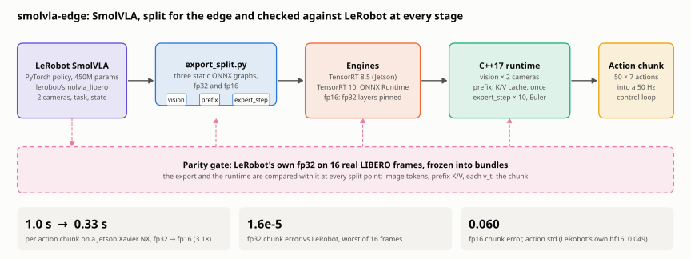
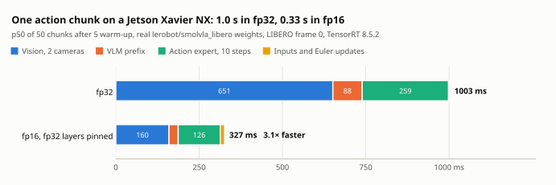
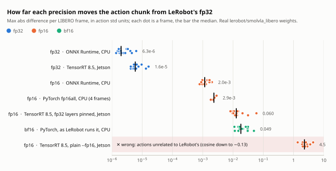
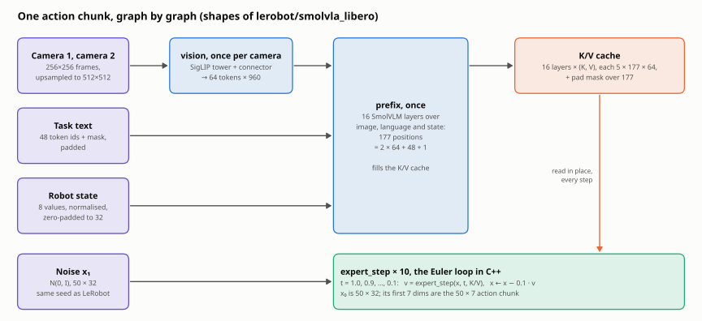
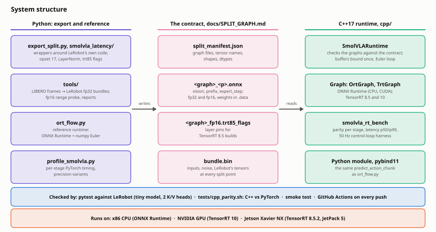

# smolvla-edge

[](https://github.com/jakhon37/smolvla-edge/actions/workflows/ci.yml)
[](LICENSE)

**Hugging Face's SmolVLA robot policy on a Jetson, three times faster, without changing what it does.**

[SmolVLA](https://huggingface.co/papers/2506.01844) is the 450M-parameter vision-language-action policy in [LeRobot](https://github.com/huggingface/lerobot): camera images, a task sentence and the robot's state in, a chunk of 50 actions out. This repo splits it into three ONNX graphs, runs them from C++ on ONNX Runtime or TensorRT, and checks every stage against LeRobot's own fp32 before claiming any speed-up. On a Jetson Xavier NX one action chunk takes 1.0 s in fp32 and 0.33 s in fp16.

The question behind it: where does SmolVLA's time go on a small GPU, and what do lower precisions and TensorRT buy without changing its actions?

<picture>
  <source media="(prefers-color-scheme: dark)" srcset="docs/figures/overview-dark.svg">
  
</picture>

## Results

Real [`lerobot/smolvla_libero`](https://huggingface.co/lerobot/smolvla_libero) weights on 16 frames of the LIBERO dataset it was trained on, against LeRobot's own `predict_action_chunk` with the same inputs and noise.

<picture>
  <source media="(prefers-color-scheme: dark)" srcset="docs/figures/jetson_latency-dark.svg">
  
</picture>

| Jetson Xavier NX, TensorRT 8.5.2 | fp32 | fp16 |
|---|---|---|
| Action chunk, p50 on frame 0 | 1003 ms | 327 ms |
| Chunk error vs LeRobot's fp32, worst of 16 frames, in action std | 1.6e-5 | 0.060 |
| Peak memory of a run | 4.4 GB | 2.7 GB |

<picture>
  <source media="(prefers-color-scheme: dark)" srcset="docs/figures/precision_accuracy-dark.svg">
  
</picture>

fp16 on the Jetson lands in the range of the bf16 that LeRobot itself runs this checkpoint in, but only once TensorRT is held to the graphs' fp32 parts. Every experiment and number: [Experiments and results](docs/EXPERIMENTS.md).

## What I found

1. **TensorRT 8.5's `--fp16` returns wrong actions, silently.** It has no strongly typed mode, and its fused kernels compute in fp16 what the graph keeps in fp32. The engines build and run, and their actions are unrelated to LeRobot's, with a cosine as low as -0.13. Pinning every layer the graph types as fp32 fixes it for 2.5% of the speed. → [Jetson](docs/JETSON.md#fp16-with-the-real-weights)
2. **An opset 18 graph builds, runs, and is wrong on TensorRT 8.5.** Its parser ignores `ReduceMean`'s axes input and averages every RMSNorm over every axis: on the tiny model the chunk moved by 0.18, with no error. torch.onnx, asked for opset 17, had quietly kept two graphs at 18. → [Jetson](docs/JETSON.md#what---for-tensorrt85-changes)
3. **LeRobot runs this checkpoint in bf16, not fp32.** The code decides it, through `load_vlm_weights`, and bf16 moves the actions 4 to 11 times as far as fp16 does on the same frames. → [Precision](docs/PRECISION.md)
4. **A K/V layout bug is invisible with one key/value head.** Reading the cache as `[P, Hkv, Dh]` instead of `[Hkv, P, Dh]` moved the chunk by 0.24 with two heads, and not at all with one. Every parity test runs a two-head model. → [C++ runtime](docs/CPP_RUNTIME.md)
5. **On a Jetson, "available" memory is not available to CUDA.** CUDA memory comes from nvmap, which does not reclaim the page cache, so the third engine failed to load with 1.3 GB shown available. The runtime now drops each engine file from the cache once read. → [Jetson](docs/JETSON.md#fp32-with-the-real-weights)
6. **The C++ runtime matches PyTorch to 4.8e-7** and kept a 50 Hz control loop fed for 10,000 ticks without one going empty (tiny model, CPU). → [C++ runtime](docs/CPP_RUNTIME.md)

## How it works

<picture>
  <source media="(prefers-color-scheme: dark)" srcset="docs/figures/data_flow-dark.svg">
  
</picture>

`vision` runs once per camera, `prefix` once to fill the K/V cache, and `expert_step` ten times in the flow-matching loop, which stays in C++. Each split point is also a checkpoint: image tokens, K/V, every velocity and the chunk are compared with LeRobot's. [How it works](docs/HOW_IT_WORKS.md) walks through it; [the contract](docs/SPLIT_GRAPH.md) pins every tensor.

<picture>
  <source media="(prefers-color-scheme: dark)" srcset="docs/figures/architecture-dark.svg">
  
</picture>

## Quickstart

No GPU and no Hugging Face Hub access needed: a tiny random model checks the export and the runtime against LeRobot.

```bash
git clone https://github.com/jakhon37/smolvla-edge && cd smolvla-edge
WITH_TRT=0 bash scripts/setup_env.sh                  # Python 3.12 venv in ~/venvs/smolvla, LeRobot 0.6.1
bash tests/smoke_test.sh ~/venvs/smolvla/bin/python   # tiny random model, offline
~/venvs/smolvla/bin/python -m pytest tests            # split-graph parity against LeRobot
```

On a GPU, `bash scripts/setup_env.sh && bash scripts/run_p0.sh` profiles every precision variant and builds TensorRT engines of the vision encoder: see [Getting started](docs/GETTING_STARTED.md). On a Jetson, follow [the step-by-step guide](docs/JETSON.md#step-by-step).

## Documentation

| Guide | What is in it |
|---|---|
| [Getting started](docs/GETTING_STARTED.md) | Setup, the GPU run, the offline tests |
| [How it works](docs/HOW_IT_WORKS.md) | The split, one chunk step by step, the system structure, a map of the repo |
| [Experiments and results](docs/EXPERIMENTS.md) | Every experiment, its setup and its numbers |
| [Jetson Xavier NX](docs/JETSON.md) | Step by step on JetPack 5, fp32 and fp16 results, the TensorRT 8.5 traps, memory |
| [C++ runtime](docs/CPP_RUNTIME.md) | Build, API, bench, measurements, the control-loop harness |
| [Precision layout and method](docs/PRECISION.md) | Which dtypes LeRobot really runs, the variants, how timing and parity are taken |
| [Split-graph contract](docs/SPLIT_GRAPH.md) | Every tensor's name, shape, dtype and layout; the Euler rule; the bundle format |
| [Real weights on the CPU](results/REAL_WEIGHTS_CPU.md) | The full real-weights write-up, with the fp16 range probe |

## Status

- **Measured:** the split graphs and the C++ runtime against LeRobot on the CPU, in CI on every push; the real checkpoint in every precision on the CPU; fp32 and fp16 on a Jetson Xavier NX.
- **Not yet:** closed-loop task success, which numerical parity does not imply (paired simulator rollouts are next); any GPU but the Xavier NX; sustained load, or a robot stack running beside the policy on the Jetson.

## Prior work

**Tether**
- Exports SmolVLA and other VLAs to ONNX and TensorRT. It reports 19.49 ms for SmolVLA with the TensorRT execution provider vs 108.11 ms with ONNX Runtime CUDA, on an A10G.
- It is BSL-1.1 licensed. Nothing here is derived from its code.

**This repo adds**
- Per-component timing on the original PyTorch stack.
- A precision layout that matches what LeRobot actually runs, checked against LeRobot.
- A strongly typed FP16 path that survives TensorRT 11's removal of weak typing.
- The real checkpoint on a Jetson Xavier NX, fp32 and fp16, with the changes TensorRT 8.5 needs to compute it correctly.

## Licence

Apache-2.0. SmolVLA checkpoints and SmolVLM2 weights keep their own licences.
