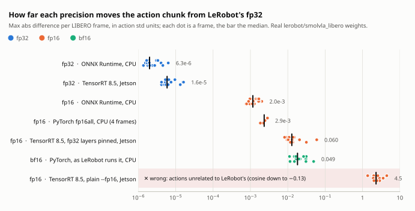
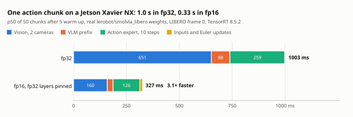

# Experiments and results

Every result here compares against one reference: LeRobot's own `predict_action_chunk` in fp32, run on the same inputs with the same flow-matching noise. Every number is in a JSON file in [`results/`](../results), and [`tools/make_figures.py`](../tools/make_figures.py) draws the charts from those files.

| # | Experiment | Where | Model | Result | Details |
|---|---|---|---|---|---|
| 1 | The split graphs against LeRobot | CPU, in CI | tiny random; SmolVLM2-500M sizes | fp32 chunk within 4.8e-7 and 7e-7 (gate 1e-5) | [How it works](HOW_IT_WORKS.md#split-graph-export) |
| 2 | The C++ runtime: parity, latency, a 50 Hz control loop | 4-vCPU VM | tiny random | within 4.8e-7 of PyTorch; 288 ms per chunk on one core; no tick without an action in 10k | [C++ runtime](CPP_RUNTIME.md) |
| 3 | Real weights, every precision against fp32 | CPU, one thread | `lerobot/smolvla_libero`, 16 LIBERO frames | fp32 6.3e-6, fp16 2.0e-3, LeRobot's bf16 4.9e-2 | [below](#real-weights-on-the-cpu) |
| 4 | Real weights on TensorRT 8.5, fp32 | Jetson Xavier NX | same | 1.6e-5, 1003 ms per chunk | [Jetson](JETSON.md#fp32-with-the-real-weights) |
| 5 | Real weights on TensorRT 8.5, fp16 | Jetson Xavier NX | same | 0.060, 327 ms per chunk | [Jetson](JETSON.md#fp16-with-the-real-weights) |

## Precision against LeRobot's fp32

<picture>
  <source media="(prefers-color-scheme: dark)" srcset="figures/precision_accuracy-dark.svg">
  
</picture>

| Chunk vs LeRobot's fp32, max abs in action std | Frames | Median | Worst |
|---|---|---|---|
| fp32, ONNX Runtime, CPU | 16 | 2.0e-6 | 6.3e-6 |
| fp32, TensorRT 8.5, Jetson | 16 | 5.9e-6 | 1.6e-5 |
| fp16, ONNX Runtime, CPU | 16 | 1.2e-3 | 2.0e-3 |
| fp16, PyTorch `fp16all`, CPU | 4 | 2.3e-3 | 2.9e-3 |
| fp16, TensorRT 8.5 with the fp32 layers pinned, Jetson | 16 | 0.013 | 0.060 |
| bf16, PyTorch as LeRobot runs this checkpoint, CPU | 16 | 0.018 | 0.049 |
| fp16, TensorRT 8.5, plain `--fp16`, Jetson | 16 | 2.3 | 4.5 |

- **fp32 matches everywhere.** The split graphs, the C++ loop and TensorRT 8.5 stay within 1.6e-5 of LeRobot on every frame.
- **fp16 is close to fp32 in software and further on TensorRT.** On the CPU, ONNX Runtime and PyTorch keep fp16 within 3e-3. TensorRT 8.5 with the fp32 layers pinned lands at 0.013 median, in the range of the bf16 that LeRobot itself runs this checkpoint in. Where TensorRT's extra error comes from was not examined.
- **Plain `--fp16` on TensorRT 8.5 is wrong, silently.** It builds, runs and returns finite actions unrelated to LeRobot's. [Why](JETSON.md#fp16-with-the-real-weights).

## Real weights on the CPU

Experiments 1 and 2 used random weights. This run used the real [`lerobot/smolvla_libero`](https://huggingface.co/lerobot/smolvla_libero) checkpoint and 16 real frames of [`lerobot/libero`](https://huggingface.co/datasets/lerobot/libero), the dataset its training config names: 4 episodes, one task from each LIBERO suite, 4 frames each, both cameras, state and task. Everything went through the checkpoint's own pre- and postprocessors, and each frame got the same noise in every runtime.

CPU only, on a 4-vCPU Xeon VM. Every measurement ran on one core and one thread. The exception is `export_split.py`'s own check, which used ONNX Runtime's default pool of 4 threads on that core.
- [`results/REAL_WEIGHTS_CPU.md`](../results/REAL_WEIGHTS_CPU.md) has the details and [`results/real_weights_cpu.json`](../results/real_weights_cpu.json) the numbers.
- `bash scripts/run_real_weights_cpu.sh PYTHON WORK_DIR` reproduces the run from the Hub. A rerun of its `inputs`, `bundles`, `fp32` and `fp16` steps with the committed tools reproduced those steps' numbers bit for bit, timings aside.
- The reference is LeRobot's `predict_action_chunk` in fp32. Its actions are 0.07 std from the dataset's demonstrated actions on average over the first 10 steps, against 0.72 for the mean action, so weights and preprocessing are right.

Against that reference, worst case over the 16 frames, in normalised action space (units of each action dimension's std):

| | Max abs | Cosine, smallest | Non-finite |
|---|---|---|---|
| Split graphs fp32, `ort_flow.py` and the C++ runtime (same numbers) | 6.3e-6 | 0.9999999999996 | 0 |
| Split graphs fp16, `ort_flow.py` and the C++ runtime (same numbers) | 2.0e-3 | 0.99999992 | 0 |
| PyTorch `fp16all`, `fp16vlm`, `amp` (4 of the frames) | 2.9e-3 | 0.99999975 | 0 |
| PyTorch `lerobot`: bf16, what LeRobot runs for this checkpoint | 4.9e-2 | 0.99995 | 0 |
| PyTorch `bf16vlm`, `bf16all` | 3.7e-2, 3.2e-2 | 0.99996 | 0 |

`lerobot_amp` fails on the CPU, as expected (`mixed dtype`).

**fp16 is safe for this checkpoint on these frames**, under the two conditions below:
- **The probe.** Every floating-point intermediate tensor of the three fp16 graphs was made a graph output and read on all 16 frames, each fp16 tensor as it rounds to fp16. One overflowed: the cube `x^3` inside the tanh GELU of the last two SigLIP layers, which the exporter writes out node by node. ONNX Runtime's CPU provider handed the next nodes the fp32 cube. An engine that keeps every node in fp16 overflows the three nodes after the cube too.
- **The overflow is harmless where it was checked.** tanh saturates. Evaluated node by node in IEEE fp16 (numpy), the formula still returns x or 0, exactly, wherever the cube overflows, and no finite fp16 input gives a non-finite output. On ONNX Runtime's CPU provider the chunk stays finite. GPU kernels were not tested.
- **The margins.** Outside the GELU, the largest fp16 tensors are the vision residual stream at 663.5 and the VLM residual stream at 7732, 8.5 times below fp16's 65504. Inside the GELU, the nodes after the cube reached 50912 in this run, 1.29 times below, and the cube itself reached 26768 in a layer where it did not overflow. All of these feed tanh. The vision attention scores, the only fp16 ones, stay within ±48.
- **Condition 1: the fp32 parts stay fp32.** The fp16 graphs are strongly typed and keep some tensors in fp32: the RMSNorm statistics (the VLM's residual stream squared reaches 6.0e7), the VLM's and the expert's attention scores, softmax and masks, RoPE, and the expert's time embedding (values up to 4096). The vision tower's LayerNorm statistics must stay fp32 too (ONNX's default `stash_type`), since its inputs reach 663.5. A runtime has to honour these types; TensorRT 8.5 does not by itself ([Jetson Xavier NX](JETSON.md)).
- **Condition 2: 16 frames are a small sample.** The margins come from these frames only.
- **bf16 moves the actions more than fp16.** On the four frames where both ran, LeRobot's own bf16 moved the chunk 4 to 11 times as far as PyTorch's `fp16all`, and up to 15 times as far as `fp16vlm` and 12 as far as `amp`.
- **The CPU's fp16 chunk is optimistic.** ONNX Runtime's CPU provider computes the fp16 graphs' matrix products in fp32, so its fp16 chunk is likely closer to fp32 than a GPU's. On the same frames it gave 1.2e-3, against 2.9e-3 for PyTorch's `fp16all`, which rounds every fp16 operation's output.

CPU latency on one thread, p50: a chunk takes 9.4 s in PyTorch fp32, 10.1 s with the fp32 split graphs from Python and 9.95 s from C++. bf16 and fp16 are slower on this CPU, which has no arithmetic for either: PyTorch bf16 24.6 s, PyTorch fp16 64.7 s, fp16 graphs 11.2 to 12.1 s. These say nothing about a GPU.

**Not tested:**
- any GPU but the Xavier NX, where [fp32 and fp16 engines ran](JETSON.md);
- whether TensorRT keeps the fp32-typed tensors in fp32 inside its fused kernels. TensorRT 8.5 does not unless each layer is pinned; with the pins its chunks land in bf16's range, but the kernels report nothing per layer;
- how a fused GPU GELU kernel treats the GELU's infinite intermediate;
- other checkpoints, more frames, and closed-loop success.

## On the Jetson

<picture>
  <source media="(prefers-color-scheme: dark)" srcset="figures/jetson_latency-dark.svg">
  
</picture>

| p50 (p99), frame 0, ms | fp32 | fp16, fp32 layers pinned |
|---|---|---|
| Action chunk | 1003 (1020) | 327 (336) |
| Vision, per camera | 326 (342) | 80 (84) |
| VLM prefix | 88 (98) | 28 (29) |
| Action expert, per step | 25.9 (26.4) | 12.6 (13.9) |
| Inputs to the GPU | 1.4 (1.7) | 11.1 (12.5) |

The [Jetson page](JETSON.md) has the conditions, the memory on that board, the build steps, and the two TensorRT 8.5 traps.

## What none of this shows

- **Closed-loop task success.** Every check is numerical parity on fixed frames. Paired simulator rollouts are the next project.
- **Any GPU but the Xavier NX.** The PyTorch profile and the TensorRT 10 path are ready for one, untested.
- **More than 16 frames, or other checkpoints.** The fp16 margins come from these frames.
