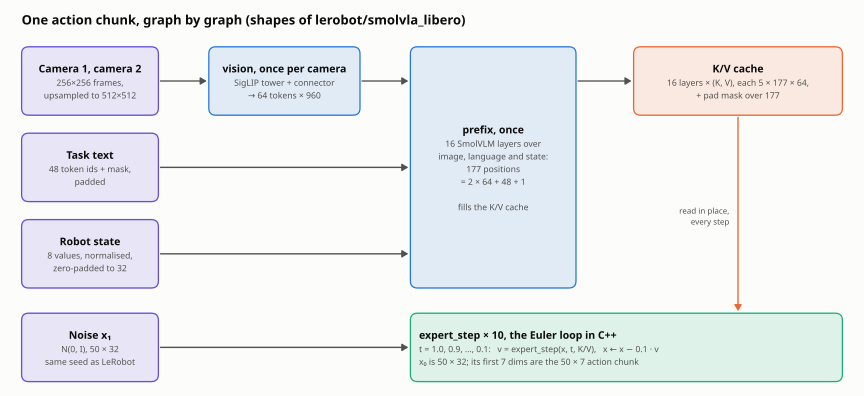
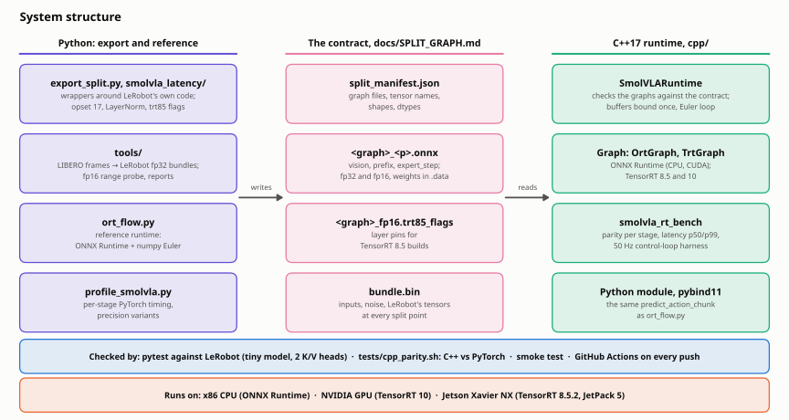

# How it works

SmolVLA is Hugging Face's 450M-parameter vision-language-action policy in [LeRobot](https://github.com/huggingface/lerobot): camera images (two on LIBERO), a task sentence and the robot's state in, a chunk of 50 actions out. This repo measures one action-chunk call at batch size 1, split into components:

| Component | What it is |
|---|---|
| Vision encoder | SigLIP tower + connector, once per camera |
| VLM prefix | 16 SmolVLM layers over image, language and state tokens; fills the KV cache |
| Action expert | 10 flow-matching steps of the smaller expert transformer reading that cache |
| Pre/post-processing | tokenise, normalise, resize-with-pad, unnormalise |
| Other glue | masks, Euler updates, Python overhead |

The study then:
- runs each precision variant on the same observation and the same flow-matching noise;
- reports latency (p50/p90/p99) and the action-chunk error against fp32;
- exports the vision encoder to ONNX and TensorRT, checking parity before claiming any speed-up.

## One action chunk

<picture>
  <source media="(prefers-color-scheme: dark)" srcset="figures/data_flow-dark.svg">
  
</picture>

- **`vision`** runs once per camera: the SigLIP tower and the connector turn a 512×512 image into 64 tokens of width 960.
- **`prefix`** runs the 16 SmolVLM layers once, over 177 positions: both cameras' tokens, the 48 language tokens and one state token. What it leaves behind is the K/V cache, post-RoPE, and a pad mask.
- **`expert_step`** is the action expert, a smaller transformer that reads that cache. Flow matching starts from noise and takes ten Euler steps, `x ← x + dt · v` with `dt = −0.1`, so it runs ten times per chunk. The loop itself stays outside the graphs, in the runtime, rounded the way LeRobot rounds it.

Why split there: a single graph would have to hold the loop and the cache. Split, a runtime keeps the K/V on the device and lets each step read it in place, and every split point is a place to compare with LeRobot. The parity checks in this repo compare image tokens, K/V, each step's velocity and the chunk, never only the final actions.

## Split-graph export

`export_split.py` exports SmolVLA as three ONNX graphs. A runtime outside Python (C++, TensorRT) can then run a whole action chunk, with the 10-step Euler loop in its own code:

| Graph | Runs | In → out (SmolVLM2-500M sizes, two LIBERO cameras) |
|---|---|---|
| `vision` | once per camera | `pixel_values [1,3,512,512]` → image tokens `[1,64,960]` |
| `prefix` | once per chunk | image tokens, language padded to 48 tokens, state → prefix mask and post-RoPE K/V of the 16 VLM layers |
| `expert_step` | 10 times per chunk | `x_t`, `t`, prefix mask, K/V → velocity `v_t [1,50,32]` |

```bash
$PY export_split.py --policy lerobot/smolvla_libero --out-dir onnx_split       # fp32 + strongly typed fp16, parity report
$PY ort_flow.py --onnx-dir onnx_split --policy lerobot/smolvla_libero --check   # ONNX Runtime chunk vs predict_action_chunk
$PY tools/dump_bundle.py --policy lerobot/smolvla_libero --out onnx_split/bundle.bin   # inputs, noise, reference actions for other runtimes
```

- `ort_flow.py` is the reference runtime: ONNX Runtime for the graphs, numpy for LeRobot's Euler update, the same noise as PyTorch.
- With random weights, offline, the fp32 action chunk matches `predict_action_chunk` to 4.8e-7 on the tiny test model and to 7e-7 at SmolVLM2-500M sizes. The tests require 1e-5.
- With the real `lerobot/smolvla_libero` weights on 16 LIBERO frames, it matches to 6.3e-6, and the fp16 graphs to 2.0e-3. See [Real weights (CPU)](EXPERIMENTS.md#real-weights-on-the-cpu).
- The tiny test model has two key/value heads (`make_fake_smolvlm.py --tiny --kv-heads 2`). With one, K/V read in the wrong memory layout would be the same numbers and pass every check.
- `export_split.py` refuses settings the graphs do not reproduce, before it reads any weights where it can: `add_image_special_tokens`, `prefix_length > 0`, an action expert with fewer layers than the VLM, and the others listed in the contract.
- [docs/SPLIT_GRAPH.md](SPLIT_GRAPH.md) is the contract. It covers:
  - graph and tensor names, shapes, dtypes and layouts;
  - the Euler rule;
  - the bundle format;
  - the three places the export deviates from LeRobot's code, and why: a float32 timestep embedding instead of float64, a functional KV cache, and a precomputed RoPE table.

## System structure

<picture>
  <source media="(prefers-color-scheme: dark)" srcset="figures/architecture-dark.svg">
  
</picture>

The Python side never runs at inference time. It exports the graphs, writes the contract, and freezes LeRobot's own outputs into bundles. The C++ runtime reads the contract, refuses graphs that do not match it, and checks itself against the bundles.

```
smolvla-edge/
├── profile_smolvla.py   per-stage PyTorch timing of every precision variant
├── export_vision.py     the vision encoder alone to ONNX, with parity
├── trt_vision.py        TensorRT build of the vision graph: strongly typed fp16, parity, timing
├── export_split.py      SmolVLA → vision, prefix, expert_step ONNX graphs, manifest, parity report
├── ort_flow.py          reference runtime: ONNX Runtime for the graphs, numpy for the Euler loop
├── plot_results.py      latency breakdown chart from profile results
├── smolvla_latency/     loading, precision variants, split-graph wrappers, ONNX rewrites, bundles
├── tools/               LIBERO inputs, LeRobot reference bundles, fp16 range probe, reports, figures
├── cpp/                 C++17 runtime: smolvla_rt library, bench, control-loop harness, unit tests
├── tests/               parity against LeRobot (pytest), C++ against PyTorch, smoke test, fake models
├── scripts/             environment setup, the GPU run, the real-weights CPU run
├── notebooks/           the GPU run on Kaggle
├── results/             every measured number, as JSON, and the real-weights write-up
└── docs/                these guides, the split-graph contract, the figures
```

## Going further

- [The split-graph contract](SPLIT_GRAPH.md): every tensor's name, shape, dtype and layout, the Euler rule, the bundle format, and where the export deviates from LeRobot's code.
- [Precision layout and method](PRECISION.md): which dtype each part runs in under LeRobot, and how timing and parity are measured.
- [C++ runtime](CPP_RUNTIME.md) and [Jetson Xavier NX](JETSON.md): building and running it, with measurements.
