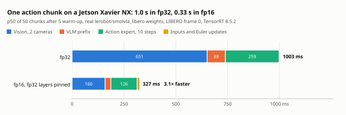
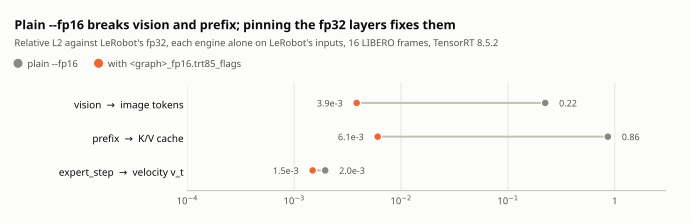

# Jetson Xavier NX (TensorRT 8.5)

A Xavier NX stays on JetPack 5: TensorRT 8.5.2, CUDA 11.4, Ubuntu 20.04. NVIDIA says JetPack 6 does not support Xavier, and TensorRT 10 targets Turing and newer, while this GPU is Volta (`sm_72`). So `export_split.py --for-tensorrt85` writes graphs for it, and this page shows how they run there.

<picture>
  <source media="(prefers-color-scheme: dark)" srcset="figures/jetson_latency-dark.svg">
  
</picture>

## What `--for-tensorrt85` changes

The flag changes three things. TensorRT 8.5 cannot import `LayerNormalization`, so it is written as basic ops, its statistics in fp32. Each fp16 graph gets a `<graph>_fp16.trt85_flags` file, the `trtexec` flags without which its engine gives wrong actions ([fp16](#fp16-with-the-real-weights), below). And the graphs are really opset 17:

- **Opset 18 builds and runs, and gives wrong numbers.** TensorRT 8.5's parser accepts an opset 18 `ReduceMean` without an error but ignores its axes input and averages over every axis, so every RMSNorm is wrong. On the tiny model the action chunk moved by 0.18 and the prefix K/V by 1.1. Only the parity check showed it.
- **`--opset 17` alone used to leave two of the graphs at 18.** ONNX's version converter fails on `prefix` and `expert_step`, and torch.onnx only logs that. `export_split.py` now lowers them itself and refuses any graph that comes out at another opset than the one asked for.

`lang_tokens` is int32 in these engines, since TensorRT 8.5 has no int64; `SmolVLARuntime` narrows it.

## Step by step

The commands behind the measurements here, from a PC with this repo's venv to the board. Nothing is installed on the Jetson: JetPack 5's CMake is 3.16 and `cpp/CMakeLists.txt` needs 3.18, so the bench is compiled with g++ directly.

1. **On the PC: graphs and a reference bundle.** The bundle holds the inputs, the noise and LeRobot's fp32 tensors at every split point. For the 16 LIBERO frames, `tools/real_inputs.py` and `tools/real_weights_split.py bundles` write one bundle per frame ([Experiments](EXPERIMENTS.md#real-weights-on-the-cpu)).

   ```bash
   PY=~/venvs/smolvla/bin/python
   $PY export_split.py --policy lerobot/smolvla_libero --out-dir onnx_split --for-tensorrt85   # fp32 and fp16
   $PY tools/dump_bundle.py --policy lerobot/smolvla_libero --out onnx_split/bundle.bin
   ```

2. **Copy the sources and the graphs**, and nlohmann/json 3.11.3's headers, the release CMake would fetch:

   ```bash
   rsync -a cpp onnx_split jetson:smolvla/
   ssh jetson 'cd smolvla && curl -sL https://github.com/nlohmann/json/releases/download/v3.11.3/json.tar.xz | tar -xJ'
   ```

3. **On the Jetson: build `smolvla_rt_bench`** with the TensorRT backend and without ONNX Runtime:

   ```bash
   cd ~/smolvla && mkdir -p gen/smolvla_rt obj
   sed -e "s/@SMOLVLA_RT_HAS_ORT@/0/" -e "s/@SMOLVLA_RT_HAS_TENSORRT@/1/" -e "s/@PROJECT_VERSION@/0.1.0/" \
     cpp/include/smolvla_rt/build_config.h.in > gen/smolvla_rt/build_config.h
   FLAGS="-std=c++17 -O2 -DNDEBUG -ffp-contract=off -Wall -Wextra -Wpedantic -Wshadow -Werror -Wno-deprecated-declarations
     -Igen -Icpp/include -Icpp/src -isystem json/include -isystem /usr/local/cuda/include -isystem /usr/include/aarch64-linux-gnu"
   for f in $(ls cpp/src/*.cpp cpp/tools/bench.cpp | grep -v ort_graph.cpp); do
     g++ $FLAGS -c "$f" -o "obj/$(basename "$f" .cpp).o"
   done
   g++ obj/*.o -o smolvla_rt_bench -L/usr/local/cuda/lib64 -lnvinfer -lcudart -pthread -Wl,-rpath,/usr/local/cuda/lib64
   ```

4. **Build the engines**, one per graph and precision. fp16 takes the flags the export wrote; real fp32 weights need the [memory steps](#building-the-fp32-engines-takes-most-of-the-boards-memory) for `prefix`.

   ```bash
   T=/usr/src/tensorrt/bin/trtexec
   for g in vision prefix expert_step; do
     $T --onnx=onnx_split/${g}_fp16.onnx --noTF32 $(cat onnx_split/${g}_fp16.trt85_flags) --buildOnly \
       --saveEngine=onnx_split/${g}_fp16.engine
     $T --onnx=onnx_split/${g}_fp32.onnx --noTF32 --buildOnly --saveEngine=onnx_split/${g}_fp32.engine
   done
   ```

5. **Run the chunk against the bundle**: parity stage by stage, then latency. It exits with status 1 if the fp32 chunk misses LeRobot's by more than 1e-4.

   ```bash
   ./smolvla_rt_bench --onnx-dir onnx_split --bundle onnx_split/bundle.bin --backend trt --precision fp32 \
     --warmup 5 --iters 50 --out fp32.json
   ./smolvla_rt_bench --onnx-dir onnx_split --bundle onnx_split/bundle.bin --backend trt --precision fp16 \
     --warmup 5 --iters 50 --out fp16.json
   ```

Judge an engine by this parity, never by a clean build: on TensorRT 8.5 both traps below build and run without an error.

## fp32 with the real weights

`lerobot/smolvla_libero` at `a24f1f3`, on the 16 LIBERO frames of [Real weights (CPU)](EXPERIMENTS.md#real-weights-on-the-cpu), same hashes, and on the synthetic observation. `smolvla_rt_bench --backend trt`: GCC 9.4, TensorRT 8.5.2, fp32 engines built with `--noTF32`, against LeRobot's fp32 on an x86-64 CPU. The report is [`results/jetson_xavier_nx_trt85_real_fp32.json`](../results/jetson_xavier_nx_trt85_real_fp32.json).

| Worst over the 16 frames | Max abs | Relative L2 |
|---|---|---|
| fp32 action chunk vs `predict_action_chunk` (gate 1e-4) | 1.6e-5 | |
| Image tokens, which reach 245 | 2.9e-4 | 1.9e-6 |
| Prefix K/V | 1.2e-4 | 2.3e-6 |
| `v_t`, 10 steps | 5.6e-4 | 7.1e-6 |

The smallest chunk cosine was 0.999999999996. The pad mask was equal, each rerun was identical and nothing was non-finite. On the CPU the same frames gave 6.3e-6 with ONNX Runtime.

| 50 chunks after 5 warm-up, p50 (p99), frame 0 | ms |
|---|---|
| Action chunk | 1003 (1020) |
| Vision, per camera | 326 (342) |
| VLM prefix | 88 (98) |
| Action expert, per step | 25.9 (26.4) |

- **Where the time goes.** Vision takes 65% of a chunk, the 10 expert steps 26% and the prefix 9%. The synthetic observation gave 997 ms.
- **Conditions.** 20 W mode, default clock governor with the GPU at its top 1109 MHz right after the run, about a minute of load (59.5 °C at the end). The desktop was off and no live robot stack ran, so this is neither sustained nor loaded latency. With the desktop on, frame 0 gave the same 4.05e-6 and 999 ms.
- **Memory.** The process peaked at about 4.4 GB. That left 1.6 GB available with the desktop off and 750 MB with it on, little room for a robot stack beside it.
- **Page cache.** CUDA memory on this board comes from nvmap, which does not reclaim the page cache. `TrtGraph` therefore drops each engine file from the cache after reading it. Without that, the third engine failed to load with the desktop on, with 1.3 GB shown available.

## Building the fp32 engines takes most of the board's memory

The `prefix` engine's workspace grows to 1 GiB. With the desktop on, that allocation fails, with 1.1 to 1.5 GB shown available, and `--memPoolSize=workspace:N` and removing tactics did not change it. It built with the desktop off and the file cache dropped, peaking at 4.9 GB and leaving 1.2 GB available:

```bash
sudo systemctl stop gdm3 nxserver; sync; sudo sh -c "echo 3 > /proc/sys/vm/drop_caches"
# build the engines; afterwards:
sudo systemctl start nxserver gdm3
```

`cudaMalloc` failed there with 1.8 GB shown available, most of it file cache, so drop the cache before a build. `vision` and `expert_step`, with a 512 MiB workspace, built with the desktop on once the cache was out. The engines took 65, 143 and 153 s for `vision`, `prefix` and `expert_step`.

## fp16 with the real weights

The same frames, observation and bench, with the fp16 graphs. The report is [`results/jetson_xavier_nx_trt85_real_fp16.json`](../results/jetson_xavier_nx_trt85_real_fp16.json). TensorRT 8.5 has no strongly typed mode, and its defaults give wrong actions:

<picture>
  <source media="(prefers-color-scheme: dark)" srcset="figures/fp16_pinning-dark.svg">
  
</picture>

- **`--fp16` is needed, and alone it is wrong.** Without it the build stops, since the parser sets fp16 on the layers the graph types as fp16. With it, Myelin, which fuses nearly every graph whole and reports nothing per layer, also computes in fp16 what the graph keeps in fp32. Each graph alone on LeRobot's inputs then misses by a relative L2 of 0.22 (`vision`) and 0.86 (`prefix` K/V), and the chunk by 1.4 to 4.5, with cosines from -0.13 to 0.91. Nothing was non-finite.
- **`<graph>_fp16.trt85_flags` holds TensorRT to the graph's types.** `--precisionConstraints=obey` with `--layerPrecisions` and `--layerOutputTypes` pins every node with an fp32 output to fp32: 200, 629 and 619 nodes in `vision`, `prefix` and `expert_step`.
- **`expert_step` needs all its Sigmoids in fp32.** The time MLP's Sigmoid is fp32 and the expert MLPs' 16 are fp16. Myelin gives the constant 1 of a fused block's Sigmoids one type, and with only the fp32 nodes pinned the build fails ("Could not infer output types"). So the flags put the 16 in fp32 as well.

| Chunk vs `predict_action_chunk`, max abs in action std, 16 frames | Median | Worst |
|---|---|---|
| fp16 engines with the flags, Xavier NX | 0.013 | 0.060 |
| LeRobot's own bf16, PyTorch on the CPU | 0.018 | 0.049 |
| PyTorch `fp16all` on the CPU, frames 1, 5, 9 and 13 | 0.0023 | 0.0029 |
| fp16 graphs on ONNX Runtime's CPU provider | 0.0012 | 0.0020 |

- **In bf16's range, not the CPU's.** The engines came closer to fp32 than LeRobot's bf16 on 11 of the 16 frames, but went 4.3 to 5.6 times as far as PyTorch's `fp16all` on its four frames. The smallest cosine was 0.999975, nothing was non-finite, each rerun was identical and the pad mask was equal. The synthetic observation gave 0.025.
- **The error upstream is even; the denoising decides.** Through the pipeline, the image tokens (values up to 245) and the prefix K/V differ from LeRobot's by a relative L2 of 3.4e-3 to 5.8e-3 and 6.3e-3 to 7.2e-3 on every frame. How far the ten Euler steps carry that differs: frame 10's chunk moved by 0.060, the others' by 0.008 to 0.031. bf16's worst frame is another one, 12.
- **Each graph alone** on LeRobot's inputs: relative L2 3.9e-3 (`vision`), 6.1e-3 (`prefix` K/V) and 1.5e-3 (`expert_step`'s `v_t`). The max abs is 4.5 (`expert_step`) to 18 (`prefix`) times ONNX Runtime's on the CPU, which multiplies the matrices in fp32. The flags pin the layers' types, not how TensorRT's fp16 kernels accumulate; where the extra error comes from was not examined.

| 50 chunks after 5 warm-up, p50 (p99), frame 0, ms | fp16 | fp32 |
|---|---|---|
| Action chunk | 327 (336) | 1003 (1020) |
| Vision, per camera | 80 (84) | 326 (342) |
| VLM prefix | 28 (29) | 88 (98) |
| Action expert, per step | 12.6 (13.9) | 25.9 (26.4) |
| Inputs to the GPU | 11.1 (12.5) | 1.4 (1.7) |

- **3.1 times as fast.** Vision 4.1 times, the prefix 3.2 and an expert step 2.1. Keeping the fp32 parts cost 2.5%: without the flags a chunk took 319 ms. Converting the camera images to fp16, on the CPU, takes 3% of the chunk.
- **Conditions.** As for fp32, but with the desktop on (fp32 gave 999 ms with it on), and 53 °C at the end. On the synthetic observation the chunk took 329 ms, with a p99 of 396 ms.
- **Memory.** All three engines built with the desktop on, in 130, 167 and 170 s; the `vision` build peaked at 4.2 GB. A run peaked at 2.7 GB and left 2.1 GB available, against 750 MB in fp32 with the desktop on. The engines take 197, 392 and 204 MB.

## Tiny random model

The same flow on the tiny random test policy (2 key/value heads). The report is [`results/jetson_xavier_nx_trt85_tiny_fp32.json`](../results/jetson_xavier_nx_trt85_tiny_fp32.json).

| Check | Max abs | Cosine |
|---|---|---|
| fp32 action chunk vs `predict_action_chunk` | 1.6e-6 | 0.9999999999998 |
| Image tokens | 3.5e-6 | 0.9999999999997 |
| Prefix K/V | 1.4e-5 | 0.9999999999984 |
| `v_t`, 10 steps | 1.1e-5 | 0.9999999999922 |

The pad mask was equal, a rerun was identical and nothing was non-finite. The engine builds took 22, 107 and 120 s for `vision`, `prefix` and `expert_step`.

## Not tested on the Jetson
- Sustained load, pinned clocks, or the policy running beside a live robot stack on the same board.
- Closed-loop success, in either precision, and fp16 on more than these 16 frames.
- The CMake build: JetPack's apt offers CMake 3.16, and `cpp/CMakeLists.txt` needs 3.18. This run compiled `cpp/src` (without `ort_graph.cpp`) and `cpp/tools/bench.cpp` with g++ directly, with `-ffp-contract=off`, and linked `-lnvinfer -lcudart`. The C++ unit tests and ONNX Runtime did not run there.
